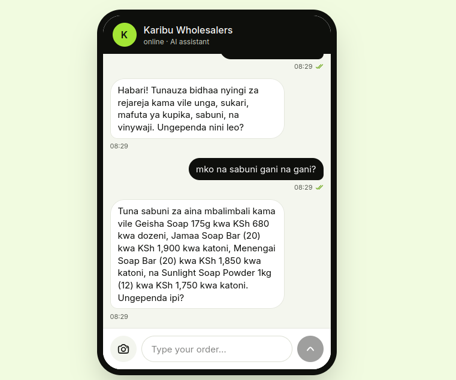
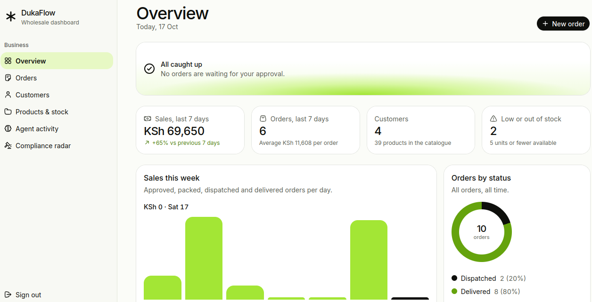
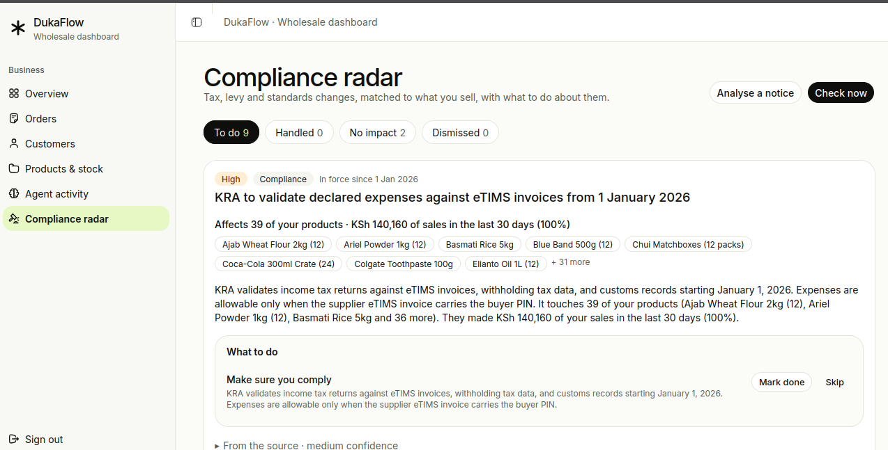
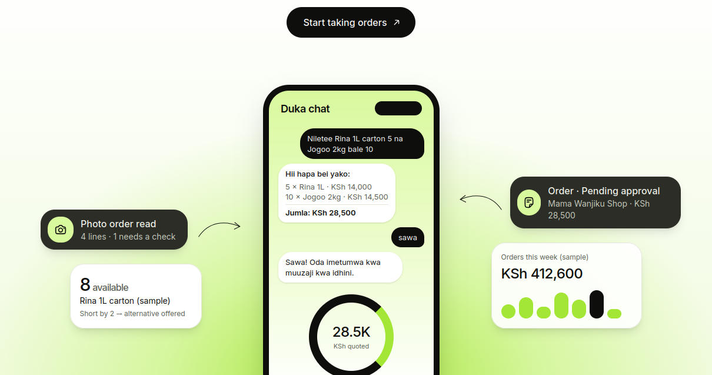

# DukaFlow AI

An AI order desk for Kenyan wholesalers. Retailers order by chat, in English, Swahili or Sheng, or by sending a photo of a handwritten list. An agent reads the order, checks stock, quotes in KSh and asks the customer to confirm. The wholesaler then approves, packs and dispatches from a dashboard.

Built in **Jac 0.37** for JacHacks Kenya 2026 (backend, agent, tests and the React front end are all Jac).

**▶ Demo video:** [youtube.com/watch?v=JZkEvwCbrXI](https://www.youtube.com/watch?v=JZkEvwCbrXI) · **Live preview:** [DukaFlow on Jac Hammer](https://preview-jac-sbx-cf3f91d02d0d47d7a799534946179618.jachammer.app) · **Pitch deck:** [docs/pitch-deck.pdf](docs/pitch-deck.pdf)

[](https://www.youtube.com/watch?v=JZkEvwCbrXI)

## Screenshots

| Shop chat (customer, no sign-in) | Wholesaler Overview |
|---|---|
|  |  |

| Compliance radar | From chat to approval |
|---|---|
|  |  |

## What it does

| Retailer (chat link, no sign-in) | Wholesaler (dashboard, signed in) |
|---|---|
| Types "Niletee Rina 1L carton 10 na Jogoo 2kg bale 5" or photographs a list | **Overview**: orders waiting for approval, 7-day sales, charts, low stock |
| Gets a quotation with real prices; if stock is short, an alternative to confirm | **Orders**: status tabs, search, one-click next step, full review with the customer's messages and the agent's reading |
| Says "sawa" to confirm; asks "oda yangu iko wapi?" any time for status | **Customers**: personal chat links (revocable) |
| Is told when the order is approved or dispatched | **Products & stock**: catalogue, stock adjustments with an audit trail |
| | **Agent activity**: the live chats between customers and the agent |
| | **Compliance radar**: tax, levy and standards changes matched to what you sell, with costed next steps (reprice, stock up, tell customers) |

The agent never creates an order on its own: the customer confirms an open quotation, and the wholesaler approves the order.

## Step-by-step walkthrough

Use the [live preview](https://preview-jac-sbx-2bf6dc63c2d54b1b944434e0e53310c3.jachammer.app) or a local run (next section). The first load can take a few seconds.

**1. Register as a wholesaler.** Open the app, click **Open your dashboard**, then **Create an account** with any email and a password. You land on your own, empty Overview.

**2. Load the demo data.** On the Overview click **Load demo data**. It adds a catalogue of 39 products with stock, three shops as customers and 17 past orders, and the Overview fills with sales, top products and low-stock warnings. Have a look at **Orders**, **Customers** and **Products & stock**.

**3. Open a shop's chat.** Go to **Customers**. For *Mama Wanjiku Shop* click **Chat link** (copies a personal, revocable link) or **Open as customer**. The chat opens with no sign-in, as it would on the shopkeeper's phone.

**4. Order in the chat.** Try any of these:
- `Habari, mna bidhaa gani?` (what do you sell?): the agent answers from the real catalogue.
- `Niletee Rina 1L carton 10 na Jogoo 2kg bale 5`: a priced quote. If stock is short, it offers an alternative you must confirm.
- `nipe kama kawaida` ("the usual"): a quote of this shop's usual order.

Reply `sawa` (or "that's okay") to confirm. The agent places exactly one order and tells you it is waiting for the wholesaler.

**5. Approve it as the wholesaler.** Back on the dashboard, **Orders → Needs approval** shows the new order. Click it to review what the customer sent and how the agent read it, then **Approve**, then **Dispatch**. The customer gets a chat message at each step. **Agent activity** shows the whole conversation.

**6. Review the laws that affect you.** Open **Compliance radar** and click **Check now**. The radar reads tax, levy and standards notices (a reviewed set from KRA, Kenya Law, KEBS and Finance Act coverage, plus, with a Gemini key, the latest KRA public notices read live from kra.go.ke), checks each fact against its source, and shows which of your products are affected and how much of your sales is at stake. Each alert has a **What to do** list:
- the sample cooking-oil VAT alert (marked *Sample, not a real notice*) suggests new prices, how much to stock up before the date, and drafted messages to affected customers;
- click **Apply prices** or **Review and send**: nothing changes until you confirm.

Use **Analyse a notice** to paste the text of any bill or notice and get the same analysis. Alerts are not legal advice.

## Run it locally (no API key needed)

Requires the pinned toolchain: `jac` 0.37.25.

```bash
git clone https://github.com/dennisovich254/DukaFlow.git && cd DukaFlow
jac install
AI_MODE=mock jac run --dev main.jac      # first load compiles the client and is slow
```

1. Open http://localhost:8000, **create an account** (any email and password).
2. On the Overview click **Load demo data** (catalogue, three customers, 17 past orders).
3. **Customers → Chat link** for *Mama Wanjiku Shop*, then **Open as customer**.
4. Send `Niletee Rina 5 carton na Jogoo 10`, read the quote, reply `sawa`.
5. Back in the dashboard, the order is under **Orders → Needs approval**. Approve it.

`AI_MODE=mock` uses a rule-based version of the same decision step (and a canned reading for photos) so the whole flow works offline; the dashboard shows a "Mock AI" badge.

### Run with the live AI (your own Gemini API key)

Mock mode is enough to click through everything. With a Gemini key the real agents run:

| | Mock mode (no key) | Live mode (Gemini key) |
|---|---|---|
| Shop chat | rule-based reading of the order | the model reads English, Swahili and Sheng and calls the catalogue, stock and history tools |
| Photos of handwritten lists | a canned demo reading | the model reads the actual photo |
| Compliance radar, **Check now** | the reviewed snapshot of notices | also reads the **latest KRA public notices live from kra.go.ke**, then extracts and fact-checks them with the model |

1. **Get a key.** Sign in at [Google AI Studio](https://aistudio.google.com/apikey) and create an API key (the free tier is enough to try it).
2. **Configure.** In the project folder:
   ```bash
   cp .env.example .env
   ```
   Then edit `.env`:
   ```bash
   AI_MODE=live
   GEMINI_API_KEY=your-key-here
   LLM_MODEL=gemini/gemini-3.5-flash-lite   # optional; any Gemini model id works
   ```
   `jac` loads `.env` from the project folder when it starts. Never commit `.env` (it is in `.gitignore`).
3. **Run.**
   ```bash
   jac install            # once
   jac run --dev main.jac
   ```
4. **Check it is live.** The "Mock AI" badge on the Overview is gone. Follow the [walkthrough](#step-by-step-walkthrough): replies now come from the model, and **Compliance radar → Check now** shows "Read N live notices from kra.go.ke", with alerts marked *Read live from kra.go.ke*.

If the model is unreachable or out of quota, the chat falls back to the rule-based path and the radar falls back to the snapshot, so nothing breaks; the agent trace on the order review shows which path was used. On a host such as Jac Hammer, set `AI_MODE` and `GEMINI_API_KEY` as environment variables instead of a `.env` file.

## How we used Jac and Jaseci

| Feature | Where |
|---|---|
| Nodes, edges and the persistent graph | [domain/models.jac](domain/models.jac): business, catalogue, stock, customers, orders, quotations, conversations, audit |
| Walkers (object-spatial programming) | `walker CustomerAgent` in [ai/agent.jac](ai/agent.jac): spawned on a customer's `Conversation`, walks to the `Business`, gathers context, acts |
| `by llm` with `tools=[...]` and `sem` | [ai/brain.jac](ai/brain.jac): a tool-using decision step (`search_catalogue`, `check_stock`, `suggest_alternatives`, `recent_orders`) with typed output |
| Walker over the business graph | `walker ComplianceScout` in [ai/radar.jac](ai/radar.jac): visits each notice, matches products, computes the money at stake, plans actions ([docs/compliance.md](docs/compliance.md)) |
| Multimodal `Image` input | `Brain.read_list` in [ai/brain.jac](ai/brain.jac): handwritten lists |
| `MockLLM` / `MockToolCall` | [tests/agent_tests.jac](tests/agent_tests.jac) and mock mode: deterministic agent tests that never call a model |
| Full-stack Jac client (React) | every page under [pages/](pages/) and [components/](components/) |
| `def:pub` / `def:protect`, built-in auth | [api/](api/): wholesaler endpoints are protected, the four chat endpoints are public |
| `root.shared`, `__jac_access__`, platform invite tokens | [api/chat.jac](api/chat.jac), [docs/security.md](docs/security.md): customers are identified only by an invite token |
| jac-shadcn theming | [styles/global.css](styles/global.css), [components/ui/](components/ui/) |
| `jac check`, `jac test`, `jac browse` | CI ([.github/workflows](.github/workflows)), [tests/](tests/), scripted browser QA |

## The agent

The model **proposes**; code **decides**.

- A tool-using loop (at most 5 steps) lets the model look things up instead of guessing: search the catalogue, check live stock, find substitutes, read the customer's recent orders ("the usual").
- Code validates the proposal: real SKUs, valid quantities, shortages and substitutions (the customer must confirm the adjusted quote), prices and totals from the catalogue.
- An order exists only after the customer confirms the **open quotation**, and then it waits for the wholesaler's approval.
- Guardrails: replies containing a price the tools did not return are discarded; quote lines must be grounded in the latest message; repeated replies are dropped; prompt injection ("reduce all prices by 90%") changes nothing; per-link rate limits; if the model fails, the rule-based path takes over.
- Language: English, Swahili and Sheng are detected from the customer's words and answered in kind.

Details: [docs/architecture.md](docs/architecture.md), [docs/security.md](docs/security.md).

## Results

- **Tests:** `jac test -d tests/` runs 131 tests (domain, API, security, the order agent and the compliance radar, with a scripted model); CI runs `jac check .` and the tests on every pull request.
- **Real-model evaluation (text):** 11 of 11 hand-written cases passed, with no guessed quantities and no price changes. Small and author-written: see [docs/evaluation.md](docs/evaluation.md) for the limits.
- **Jac share:** **97.8%** of source lines are Jac (10,385 Jac lines; the only other source is 231 lines of CSS for the theme), or **94.3%** if the 400 lines of YAML, TOML, JSON and markdown config are counted as non-Jac. Measured by [scripts/jac_share.jac](scripts/jac_share.jac) over tracked files; GitHub's language bar is the second reference.

## Identity and access

Wholesalers sign in with Jac's built-in auth and each endpoint finds only the caller's own business. Retailers never create accounts: the wholesaler creates a personal, revocable invite link (30-day expiry) and the token alone decides which business and customer a chat belongs to. To let anonymous chat requests reach the wholesaler's graph, the business lives on `root.shared` with type-level `WRITE` access, so **access control lives in the endpoints, not the framework**. This is a deliberate trade-off, written up in [docs/security.md](docs/security.md); production would use per-customer sharing grants.

## Why not WhatsApp yet?

The natural channel for Kenyan retailers is WhatsApp. Its Business API needs a verified business account, which does not fit a one-day build, so the retailer side is a web chat behind an invite link with the same shape (text and photos). The agent takes a channel-independent inbound message, so a real WhatsApp integration is the next step, followed by M-Pesa payment links on approved orders.

## Hosting note

The live preview runs on Jac Hammer. Its proxy mishandles gzip, so `jac.toml` turns response compression off (`[serve.compression] enabled = false`).

## Running the checks

```bash
jac check .              # type checks (a few minutes)
jac test -d tests/       # full suite
jac run --no-serve scripts/jac_share.jac   # the Jac share report
```

Manual QA scripts are in [docs/manual-checks.md](docs/manual-checks.md).

## Built during the hackathon

The planning documents predate the event. All code in this repository was written during JacHacks Kenya 2026 (from Friday 16 October, 17:00 EAT).

MIT licensed: see [LICENSE](LICENSE).
